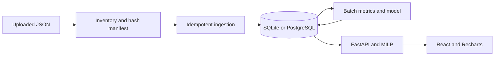
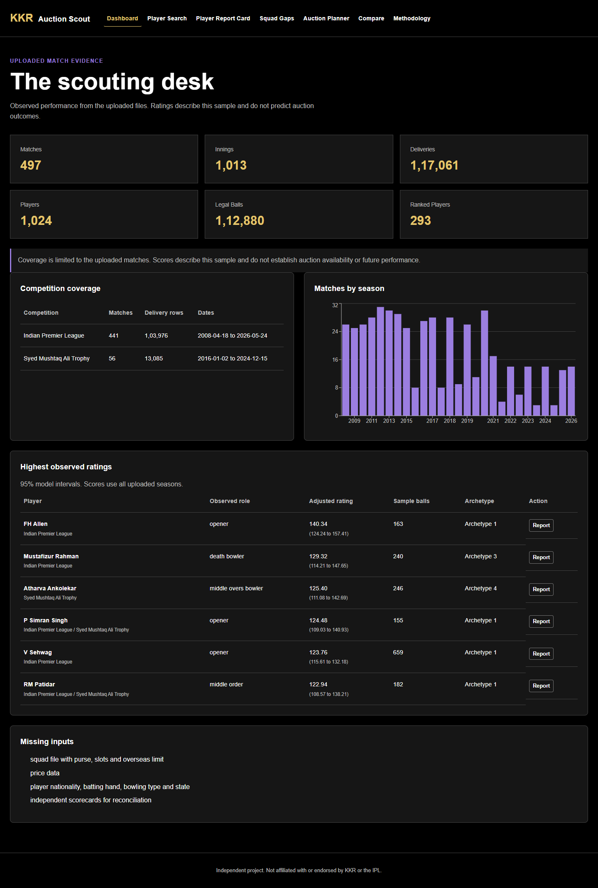

# KKR Auction Scout

A local scouting website built from the uploaded Cricsheet match files. It serves a React build from FastAPI and stores source data and batch scores in SQLite. DATABASE_URL selects PostgreSQL.

## Run

Python 3.11 or newer is required. The Git checkout includes source code and the original match JSON files under data/raw/cricsheet. Build the frontend before starting the server.

```powershell
python -m venv .venv
.\.venv\Scripts\python.exe -m pip install '.[test]'
npm --prefix frontend ci
npm --prefix frontend run build
.\.venv\Scripts\python.exe run.py
```

The last command inventories, ingests, scores and serves. Open http://127.0.0.1:8000. On Linux or macOS use `.venv/bin/python`. Ingestion skips unchanged files by hash. A changed manual override file triggers identity resolution again. Raw files are never edited.

For a source frontend build: `cd frontend`, `npm ci`, `npm run build`. Node 22 is used by Docker and CI. For pipeline-only work use `python run.py prepare`; to serve an already prepared database use `python run.py serve`.

## Uploaded data

Counts below are read from the database inventory. Delivery rows include wides, no-balls, super overs and interrupted innings.

| Competition | Matches | Innings | Delivery rows | Legal balls | Dates |
|---|---:|---:|---:|---:|---|
| Indian Premier League | 441 | 901 | 103,976 | 100,220 | 2008-04-18 to 2026-05-24 |
| Syed Mushtaq Ali Trophy | 56 | 112 | 13,085 | 12,660 | 2016-01-02 to 2024-12-15 |

All supplied sporting files are Tier A ball-by-ball. Tier B scorecard tables exist but remain empty because no such source was uploaded. No parser is fabricated for an unknown scorecard format. See [inventory](data/inventory.md) and [per-file hashes](data/upload_manifest.csv).

This is a selected match archive. The supplied README.txt describes a KKR archive, while the merged uploaded folder contains more IPL files. Actual IPL team occurrences from SQL:

| Source team spelling | Matches |
|---|---:|
| Kolkata Knight Riders | 278 |
| Kings XI Punjab | 190 |
| Mumbai Indians | 63 |
| Royal Challengers Bangalore | 58 |
| Chennai Super Kings | 55 |
| Rajasthan Royals | 52 |
| Sunrisers Hyderabad | 48 |
| Delhi Daredevils | 43 |
| Delhi Capitals | 19 |
| Deccan Chargers | 19 |
| Pune Warriors | 11 |
| Punjab Kings | 9 |
| Lucknow Super Giants | 8 |
| Gujarat Lions | 8 |
| Gujarat Titans | 6 |
| Royal Challengers Bengaluru | 4 |
| Rising Pune Supergiants | 4 |
| Rising Pune Supergiant | 4 |
| Kochi Tuskers Kerala | 3 |

Source team spellings remain intact. Historical match rosters are participants, not a current squad or an auction pool.

## Counting and scoring

**Uploaded coverage.** Metrics describe only the uploaded match subset. They are not complete competition records. Player names and IDs are read from match registries. Missing nationality, batting hand and bowling style are not inferred.

**Counting rules.** Wides and no-balls contribute neither balls faced nor legal balls bowled. Bat runs on no-balls remain in the run numerator. Byes, leg-byes and penalties are excluded from bowler runs. Run-outs are credited to the dismissed batter, including non-strikers. Super overs are stored and excluded from metrics.

**Phases and context.** The source numbers overs from zero. Fixed bands cover overs 1 to 6, 7 to 15 and 16 onward. These are fixed bands rather than inferred actual powerplays. Method-marked, shortened and no-result matches are excluded from context baselines; their observed regulation deliveries remain in player rate metrics. Baselines fall back from venue-season-phase to competition-season-phase, competition-phase and competition overall.

**Par adjustment.** Each run contribution is divided by the observed context run rate for its discipline. Batting uses bat runs per ball faced; bowling uses charged runs per legal ball. First-innings par totals use completed, scheduled full-length innings and display a t interval only when the venue-season sample meets the minimum.

**Shrinkage and intervals.** Gamma-Poisson empirical-Bayes priors are estimated from uploaded player rates after subtracting estimated sampling variance. Prior exposure is capped at the batting minimum. Scores compare adjusted rates with context: batting is proportional to scoring rate; bowling is inverse charged run rate. A score of 100 represents the context run rate before shrinkage. Scores use run rate only; dismissals and wickets are displayed separately. Intervals are 95% model intervals under the Gamma-Poisson approximation, not calibrated frequentist coverage guarantees. They ignore opposition strength, within-innings dependence and uncertainty in fitted context and league factors.

**Roles and archetypes.** Primary roles use the phase with the largest observed ball exposure. Players meeting both overall discipline thresholds receive an equal-weight batting and bowling score. Its interval is the average of the component endpoints and does not model dependence. K-means uses standardized observed phase and discipline shares, with no imputed ratings. Cluster numbers describe usage groups rather than quality. Ratings compare scoring or charged run rate within context; a rank across roles is a descriptive ordering rather than a claim of interchangeability. Spin, pace and wicketkeeping roles require missing player attributes.

**League bridges.** Bridge comparisons require the same registered player in both competitions in the same calendar year, meeting the discipline minimum in each. Mean log context-rate differences are averaged by player, with a t interval. Transfer is applied only when the bridge-player minimum is met. Sparse bridge samples retain par-adjusted metrics and are labelled as such.

**Back-test limits.** Auction dates, uncapped eligibility and sale records are absent. Match rosters do not establish auction eligibility. The separate season holdout uses only earlier records for its training rating. It reports the last uploaded year as observed and makes no claim of predictive power.

Minimum samples are policy settings stored with the batch model:

| Setting | Minimum |
|---|---:|
| batting_balls | 150 |
| bowling_balls | 120 |
| phase_balls | 30 |
| par_innings | 5 |
| par_balls | 120 |
| bridge_players | 10 |
| holdout_balls | 60 |
| holdout_players | 10 |
| confidence_level | 0.95 |
| maximum_archetypes | 4 |

Ranks and displayed score intervals are persisted in player_scores. Below the discipline minimum, scores and ranks are absent and insights say `Insufficient data`. The reported intervals are model intervals with the assumptions stated above. They do not establish predictive accuracy.

**Measured model summary.** 293 players meet an overall sample threshold. 4 usage archetypes were fitted. Adjustment label: Par-adjusted descriptive score; insufficient bridge players for league transfer.

**League adjustment, exactly as computed:**

```json
[
  {
    "competition": "Syed Mushtaq Ali Trophy",
    "reference_competition": "Indian Premier League",
    "discipline": "batting",
    "bridge_players": 0,
    "minimum_bridge_players": 10,
    "matched_calendar_years": 0,
    "sample_balls": 0,
    "factor": null,
    "ci_low": null,
    "ci_high": null,
    "status": "Insufficient bridge players; par-adjusted metrics"
  },
  {
    "competition": "Syed Mushtaq Ali Trophy",
    "reference_competition": "Indian Premier League",
    "discipline": "bowling",
    "bridge_players": 0,
    "minimum_bridge_players": 10,
    "matched_calendar_years": 0,
    "sample_balls": 0,
    "factor": null,
    "ci_low": null,
    "ci_high": null,
    "status": "Insufficient bridge players; par-adjusted metrics"
  }
]
```

**Back-test, exactly as computed:**

```json
{
  "auction_test_status": "Impossible with uploaded data",
  "auction_test_reason": "Auction dates, uncapped eligibility and sale records are absent. Match rosters do not establish auction eligibility.",
  "status": "Insufficient data",
  "competition": "Indian Premier League",
  "holdout_year": "2026",
  "train_before": "2026-01-01",
  "minimum_training_balls": 150,
  "minimum_holdout_balls": 60,
  "minimum_players": 10,
  "players": 5,
  "balls": 891,
  "innings": 40,
  "top_group_players": null,
  "top_group_sr": null,
  "other_group_sr": null,
  "difference": null,
  "ci_low": null,
  "ci_high": null,
  "correlation": null,
  "reason": "Insufficient data: 5 qualifying players; the descriptive holdout requires 10."
}
```

The requested past-auction uncapped-player test is unavailable for the reason given in this result. The separate holdout is a descriptive check. Training uses earlier records and test samples use the final uploaded calendar year; the Methodology page reports its sample and uncertainty.

Six phase findings with sample sizes and confidence intervals are generated in [EDA](reports/eda.md). The [notebook](notebooks/uploaded_sample_eda/uploaded_sample_eda.ipynb) reads them through SQL. Unweighted mean of each innings-phase total run rate. A 95% t interval treats innings as independent. It describes this uploaded subset; interrupted regulation innings remain included.

## Data quality

| Check | Status | Failures | Detail |
|---|---|---:|---|
| Duplicate source match IDs | pass | 0 |  |
| Duplicate delivery keys | pass | 0 |  |
| Invalid run reconciliation | pass | 0 |  |
| Invalid legal ball flags | pass | 0 |  |
| Invalid bowler conceded runs | pass | 0 |  |
| Innings total or ball count mismatch | pass | 0 |  |
| Null player references | pass | 0 |  |
| Orphan player references | pass | 0 |  |
| Invalid dates | pass | 0 |  |
| Overs exceeding scheduled legal-ball count | source exception | 1 | Inspect innings metadata.miscounted_overs; preserve source umpire miscounts. |
| Independent scorecard reconciliation | unavailable | Unavailable | No second-source scorecard was uploaded. Source delivery sums are checked; they are not independent verification. |

The raw files contain annotated umpire miscounts. These are preserved and tested against the source annotations. Summing deliveries verifies internal consistency; it does not replace independent scorecard reconciliation.

## Squad and planner

Squad file not loaded. The Squad Gaps page links to a working blank squad template. Supply `data/squad.csv` with database player_id values from `/players`, and optionally `data/constraints.csv` and `data/prices.csv`, then rerun the pipeline. Templates contain headers only. No retained player, purse or price was inferred or fetched from the web.

Price data not provided. The current planner maximizes the sum of precomputed scores with an analyst-entered slot count and minimum batting/bowling coverage. These are scenario settings, not an asserted team purse or slot limit. It excludes explicitly removed players and uploaded squad members. PuLP is not needed; SciPy MILP performs integer selection. Results include the next highest unselected values, which are not separate optimized squads.

When uploaded prices and a purse are available, only priced candidates enter a purse-constrained run. Candidate overseas eligibility is absent, so overseas constraints return a specific validation error. Uploaded squad role, hand and bowling type fields support coverage; absent fields remain unknown. Budget sensitivity, current retained coverage, overseas balance, age filters, spin/pace splits and auction availability are unavailable with these uploads. The site omits unsupported input controls.

## API and traceability

FastAPI documents the working endpoints at `/docs`. Core endpoints exist at `/players`, `/players/{id}`, `/squad/gaps`, `/optimize` and `/compare`, with `/api` aliases for the frontend. `/api/dashboard`, `/api/methodology`, `/health` and template downloads also work. Inputs are validated with Pydantic. Scores are read from batch output; requests do not refit the model.

| Screen values | Database origin |
|---|---|
| Dashboard counts and chart | matches, innings, deliveries SQL counts by competition/season |
| Search scores, ranks and intervals | player_scores; participation filters join match_players and matches |
| Report and compare charts | player_scores.summary_json from regulation deliveries and wickets |
| Planner total value | sum of selected player_scores.score rows |
| Methodology samples and results | pipeline_meta inventory, data_quality, methodology, model_summary and eda |

Search filters identify observed participants. Scores retain their scope across all uploaded seasons; filtering a season does not refit scores. API tests compare output values and report chart payloads against SQL. Insights use fixed templates with computed sample sizes and intervals. Source fields absent from the database show `Not in uploaded data`.



## Verification and deployment

Run `pytest -q`. Tests use real uploaded matches, including irregular innings and illegal deliveries. Build the frontend with `npm run build`. Start the server with `python run.py serve`, then run `node scripts/ui-check/ui-check.mjs` from `frontend`. Playwright Chromium must be installed using `npx playwright install chromium` if no existing executable is configured. The browser check visits every page and exercises search, filters, sorting, pagination, report selection, planner constraints, comparisons and downloads.

Docker: `docker compose up --build`. The default stack uses SQLite. For PostgreSQL, set POSTGRES_PASSWORD and a DATABASE_URL that points to the compose postgres service, then run `docker compose -f docker-compose.yml -f compose.postgres.yml up --build`. Credentials belong in environment variables and `.env` is ignored. An initial Alembic migration is supplied: `alembic upgrade head`. The normal first run creates missing tables automatically. Add new migrations for later schema changes.

Docker and a PostgreSQL server are not installed in this workspace. Their runtime paths were not executed here. PostgreSQL SQL/schema portability is checked separately. GitHub Actions runs tests and browser checks for this repository. No public deployment was requested with a destination or credentials.

## Design and source attribution

Design provenance and extracted values are stored in [tokens](design/tokens.json). The site uses a text wordmark and no copied logo or player photos. Colors, typography and spacing are defined as CSS variables; dark surfaces and text pairs are checked for WCAG AA contrast. See the design provenance result in the Methodology page.

Cricsheet match data is supplied under the Open Data Commons Attribution License. Preserve README.txt, LICENSE.txt and source attribution when redistributing the data. The archive provenance is in the supplied README.txt.

Independent project. Not affiliated with or endorsed by KKR or the IPL.

Design provenance: Approximation. Public homepage and CSS could not be read in this run. Black theme-color was supplied in the brief. Purple and gold are design approximations, not official KKR values.



## Repository layout

Each Python component has its own folder containing its code and public imports. Scripts and tests also have one folder per file. Framework configuration and the run.py entry point retain their standard locations.

```text
src/kkr_scout/<component>/<component>.py
frontend/src/main/main.jsx
frontend/src/styles/styles.css
frontend/scripts/ui-check/ui-check.mjs
scripts/<script-name>/<script-name>.py
tests/<test-name>/<test-name>.py
notebooks/uploaded_sample_eda/uploaded_sample_eda.ipynb
data/raw/cricsheet/
design/
migrations/
.github/workflows/
```

Clone with `git clone https://github.com/pratyushpachal/auction_product.git`, enter `auction_product`, and follow the README setup commands. Virtual environments, node_modules, database files, build outputs, local logs and pasted chat instructions are excluded from Git.
Verified locally: 30 pytest tests passed, frontend production build passed, 22 live endpoint calls reconciled with SQL, all 7 pages passed the browser check with 32 successful API requests and no JavaScript errors. 12 contrast checks passed. The local test run emitted one framework deprecation warning. Full records are in reports/verification.json.
